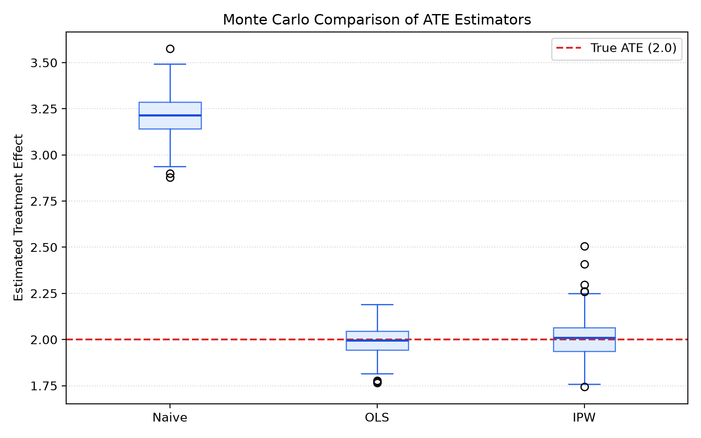

# Monte Carlo Evaluation of Treatment Effect Estimators under Confounding

This project investigates the finite-sample performance of treatment-effect estimators in observational studies subject to confounding. Using a known data-generating process with a constant average treatment effect (ATE) of 2.0, we evaluate and compare three estimators:

- **Naive difference in means**
- **OLS regression adjustment**
- **Normalized (Hájek) Inverse Probability Weighting (IPW)**

## Data-Generating Process (DGP)

For each individual, two continuous covariates are generated:

$$x_1 \sim \mathcal{N}(0, 1), \quad x_2 \sim \mathcal{N}(0, 1)$$

Treatment assignment $D \in \{0, 1\}$ follows a logistic propensity score model:

$$P(D=1 \mid X) = \mathrm{expit}(-0.3 + 0.8x_1 - 0.6x_2)$$

The observed outcome is generated according to:

$$Y = 1 + 2D + 1.2x_1 - 0.8x_2 + 0.5x_1^2 + \varepsilon, \quad \varepsilon \sim \mathcal{N}(0, 1)$$

The true theoretical Average Treatment Effect (ATE) is $\tau = 2.0$.

## Methods

1. **Naive Estimator**:
   $$\hat{\tau}_{\text{Naive}} = \bar{Y}_{D=1} - \bar{Y}_{D=0}$$
2. **OLS Regression Adjustment**:
   Fits an ordinary least squares regression of $Y$ on $D$, $x_1$, $x_2$, and $x_1^2$, controlling for all linear and non-linear confounders.
3. **Hájek IPW Estimator**:
   Estimates propensity scores $\hat{e}(X)$ via logistic regression and computes self-normalized weighted averages:
   $$\hat{\tau}_{\text{IPW}} = \frac{\sum_{i=1}^n \frac{D_i Y_i}{\hat{e}(X_i)}}{\sum_{i=1}^n \frac{D_i}{\hat{e}(X_i)}} - \frac{\sum_{i=1}^n \frac{(1 - D_i) Y_i}{1 - \hat{e}(X_i)}}{\sum_{i=1}^n \frac{1 - D_i}{1 - \hat{e}(X_i)}}$$

## Monte Carlo Design

- **Repetitions ($R$)**: 200
- **Sample size per repetition ($n$)**: 1000
- **Random seed**: 42

Metrics evaluated for each estimator:
- **Mean Estimate**: $\bar{\hat{\tau}} = \frac{1}{R} \sum_{r=1}^R \hat{\tau}_r$
- **Bias**: $\widehat{\mathrm{Bias}} = \frac{1}{R}\sum_{r=1}^{R}(\hat\tau_r-\tau)$
- **Monte Carlo Standard Deviation**: $\text{SD} = \sqrt{\frac{1}{R-1}\sum_{r=1}^R (\hat\tau_r - \bar{\hat{\tau}})^2}$
- **Root Mean Squared Error**: $\widehat{\mathrm{RMSE}} = \sqrt{\frac{1}{R}\sum_{r=1}^{R}(\hat\tau_r-\tau)^2}$

## Results

| Estimator | Mean Estimate | Bias | SD | RMSE |
|---|---:|---:|---:|---:|
| Naive | 3.2125 | 1.2125 | 0.1183 | 1.2183 |
| OLS | 1.9944 | -0.0056 | 0.0758 | 0.0759 |
| IPW (Hájek) | 2.0086 | 0.0086 | 0.1123 | 0.1124 |

- **Naive** estimation is heavily biased upward due to uncontrolled confounding from $x_1$ and $x_2$.
- Both **OLS** and **IPW** successfully eliminate the confounding bias.
- **OLS** achieves the lowest RMSE because its outcome model is correctly specified to include the true non-linear term $x_1^2$.

## Figure

The boxplot below shows the empirical distribution of the three estimators across the 200 Monte Carlo repetitions, benchmarked against the true ATE (red dashed line).



## Installation and Usage

Install the dependencies:

```bash
pip install -r requirements.txt
```

Run the simulation:

```bash
python main.py
```

The script prints the summary table above and saves the boxplot to `figures/estimator_comparison.png`.

## Project Structure

```text
.
├── figures/
│   └── estimator_comparison.png
├── main.py
├── requirements.txt
└── README.md
```
